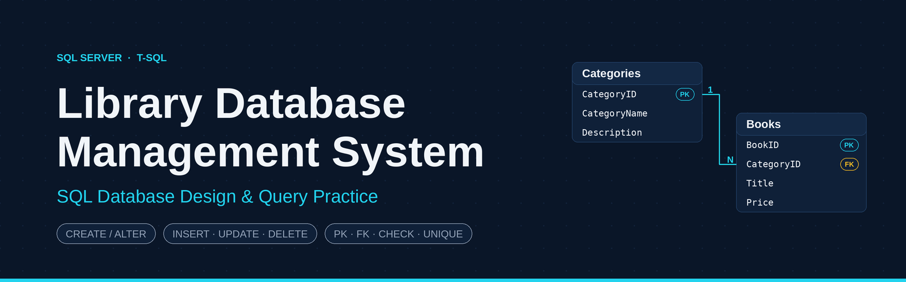
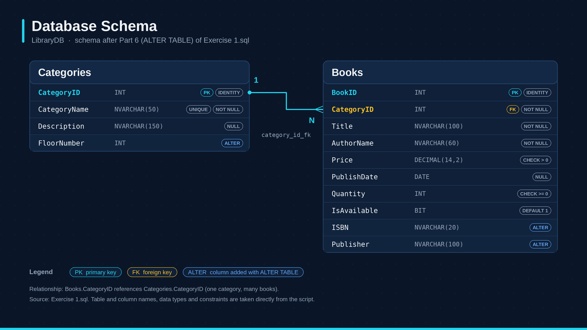
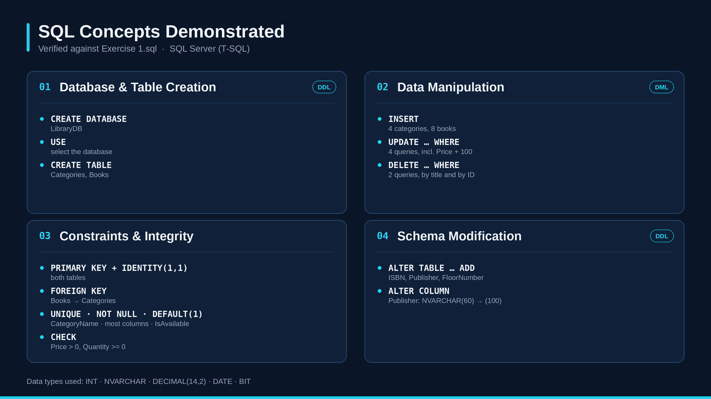
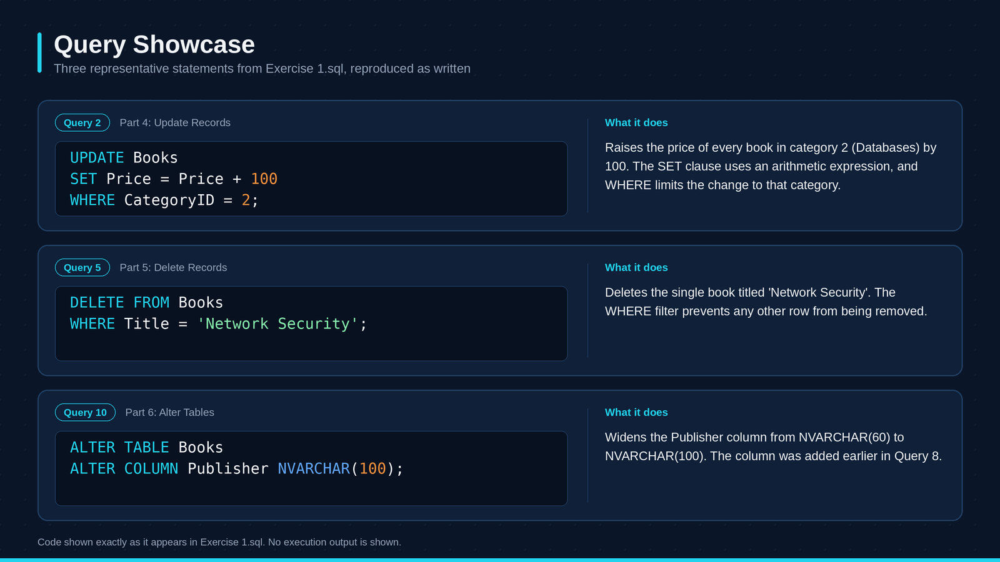

# Library Database SQL

A beginner-friendly Microsoft SQL Server / T-SQL project demonstrating relational database fundamentals through a simple library database.

## Project Overview

This project creates a database named `LibraryDB` with two related tables: `Categories` and `Books`. It demonstrates table creation, constraints, sample data insertion, record updates and deletions, and schema modifications using `ALTER TABLE`.

The project focuses on SQL fundamentals rather than a complete library management application. It does not include members, loans, authentication, stored procedures, views, or application code.

**Main SQL script:** [`library_database.sql`](library_database.sql)

## Database Schema

The database contains two tables: `Categories` and `Books`.

### Categories

| Column | Type | Definition |
|---|---|---|
| `CategoryID` | `INT` | Identity primary key |
| `CategoryName` | `NVARCHAR(50)` | Required and unique category name |
| `Description` | `NVARCHAR(150)` | Optional category description |
| `FloorNumber` | `INT` | Added later using `ALTER TABLE` |

### Books

| Column | Type | Definition |
|---|---|---|
| `BookID` | `INT` | Identity primary key |
| `CategoryID` | `INT` | Required foreign key referencing `Categories.CategoryID` |
| `Title` | `NVARCHAR(100)` | Required book title |
| `AuthorName` | `NVARCHAR(60)` | Required author name |
| `Price` | `DECIMAL(14,2)` | Required price greater than zero |
| `PublishDate` | `DATE` | Optional publication date |
| `Quantity` | `INT` | Required quantity greater than or equal to zero |
| `IsAvailable` | `BIT` | Defaults to `1` when omitted |
| `ISBN` | `NVARCHAR(20)` | Added later using `ALTER TABLE` |
| `Publisher` | `NVARCHAR(100)` | Added initially as `NVARCHAR(60)` and widened later |

### Schema Diagram

The following diagram illustrates the database structure and the relationship between the two tables.



## Database Relationship

The `Categories` and `Books` tables have a one-to-many relationship.

- One category can be associated with multiple books.
- Each book must reference an existing category through `Books.CategoryID`.
- The foreign key constraint is named `category_id_fk`.

The script inserts four categories and eight books, then performs additional data manipulation operations, including updating the category assigned to `C# Fundamentals`.

## SQL Concepts Demonstrated

This project demonstrates the following SQL Server / T-SQL concepts through practical examples.

- **Database operations:** `CREATE DATABASE` and `USE`.
- **Batch separation:** `GO`.
- **Table creation:** `CREATE TABLE`.
- **Identity columns:** `IDENTITY(1, 1)`.
- **Constraints:** primary keys, foreign keys, `UNIQUE`, `DEFAULT`, and `CHECK`.
- **Nullability:** `NULL` and `NOT NULL`.
- **Data insertion:** multi-row `INSERT` statements with explicit column lists.
- **Data types:** `INT`, `BIT`, `DATE`, `DECIMAL`, and `NVARCHAR`.
- **Unicode strings:** the `N'...'` literal notation.
- **Data updates:** `UPDATE`, `SET`, and `WHERE`.
- **Arithmetic updates:** modifying existing values using expressions.
- **Data deletion:** `DELETE` with a `WHERE` condition.
- **Schema modification:** `ALTER TABLE ... ADD` and `ALTER TABLE ... ALTER COLUMN`.

### SQL Concepts Overview



## Example Queries

The following examples are taken from the project script and demonstrate data manipulation and schema modification.

### 1. Update a Book's Price

```sql
UPDATE Books
SET Price = 500
WHERE Title = N'Python Basics';
```

Updates the price of the book matching the specified title.

### 2. Apply an Arithmetic Update

```sql
UPDATE Books
SET Price = Price + 100
WHERE CategoryID = 2;
```

Increases the price of every book belonging to category `2` by `100`.

### 3. Delete a Matching Record

```sql
DELETE FROM Books
WHERE Title = N'Network Security';
```

Deletes the book matching the specified title, if it exists.

### 4. Add and Modify a Column

```sql
ALTER TABLE Books
ADD Publisher NVARCHAR(60);

ALTER TABLE Books
ALTER COLUMN Publisher NVARCHAR(100);
```

Adds the `Publisher` column and subsequently increases its maximum character length.

### Query Showcase



## Requirements

- Microsoft SQL Server with permission to create a database.
- SQL Server Management Studio (SSMS), Azure Data Studio, or another compatible SQL Server client.
- A query runner that supports the `GO` batch separator, or a way to execute the script's batches separately.

`GO` is a client-side batch separator recognized by tools such as SSMS and `sqlcmd`. It is not a Transact-SQL statement executed directly by the SQL Server engine.

## Setup and Execution

1. Download or clone this repository.
2. Open [`library_database.sql`](library_database.sql) in SSMS or another compatible SQL Server client.
3. Connect to the intended SQL Server instance with an account authorized to create databases.
4. Review the script before executing it, particularly the `UPDATE` and `DELETE` statements.
5. Execute the script using a client that supports `GO`.
6. Refresh the database list and inspect `LibraryDB`, `dbo.Categories`, and `dbo.Books`.

### Command-Line Execution

If `sqlcmd` is installed and configured, a typical command is:

```bash
sqlcmd -S <server-name> -E -i library_database.sql
```

Use the authentication and connection options appropriate for your environment. No credentials are included in this repository.

## Validation and Limitations

The SQL script has been reviewed for T-SQL structure, statement ordering, constraints, object references, and batch boundaries. However, it has not been executed against a live SQL Server instance in this environment.

Run the script in a suitable test environment before relying on its execution results.

**Important:** The script is not idempotent. Running it again without resetting the database or handling existing objects and data may cause errors. The `UPDATE` and `DELETE` statements are part of the exercise and are not wrapped in a transaction or rollback block.

## Repository Structure

```text
.
├── .gitignore
├── README.md
├── library_database.sql
└── images/
    ├── library-database-banner.png
    ├── database-schema.png
    ├── sql-concepts.png
    └── query-showcase.png
```

## Skills Demonstrated

- SQL Server and T-SQL fundamentals
- Relational database design
- Table creation and schema modification
- Primary keys, foreign keys, and constraints
- Data insertion, updating, and deletion
- Data types and data validation
- SQL script organization and technical documentation

---

This project is an SQL fundamentals exercise focused on database structure, data manipulation, and schema changes using Microsoft SQL Server / T-SQL.
